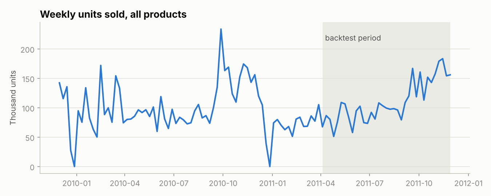
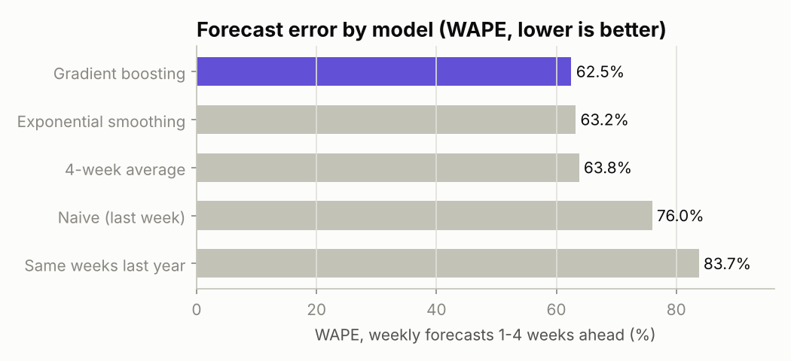
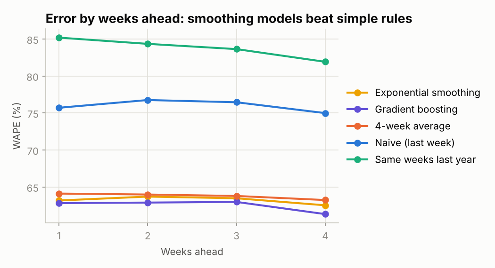
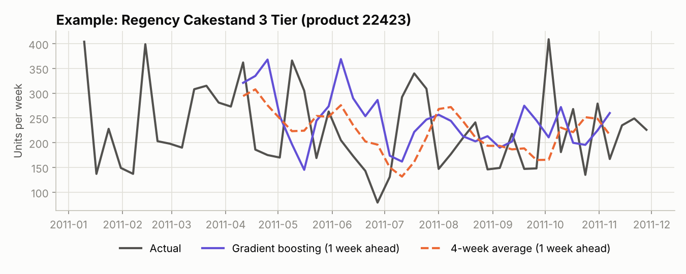
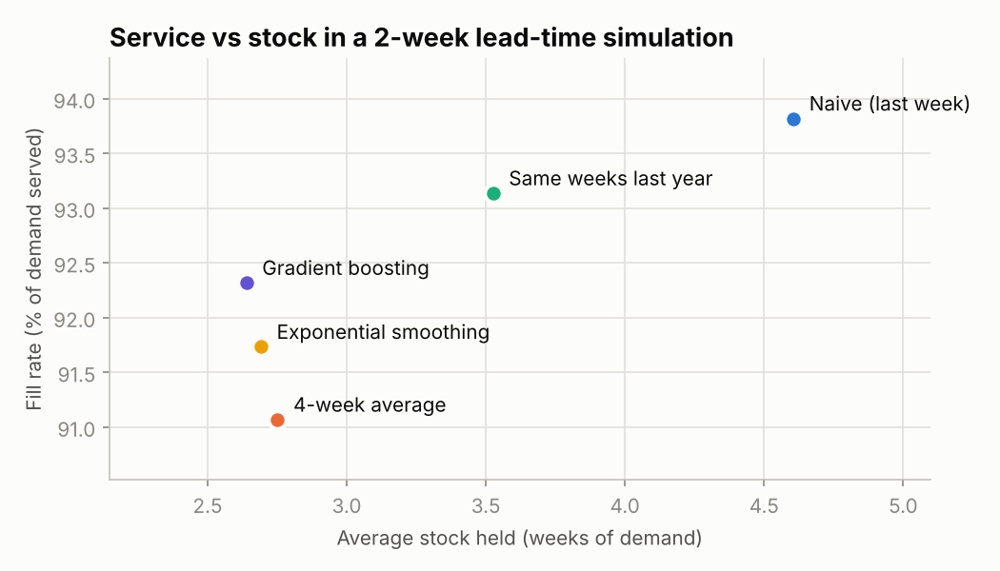

# Retail Demand Forecasting and Replenishment

Weekly demand forecasts and reorder recommendations for 877 products of a UK online
retailer, built on two years of real transactions (about 1 million invoice lines).

The project follows the path a demand planner takes: clean the sales data, forecast
what each product will sell in the next few weeks, check how accurate those forecasts
would have been, and turn them into safety stock and reorder levels.

**Main results**

- A gradient-boosted model trained across all products had the lowest error
  (WAPE 62.5% per product-week, 44.4% on 3-week totals), ahead of exponential smoothing
  (63.2%) and a 4-week moving average (63.8%), and well ahead of "same as last week"
  (76.0%).
- The gap between the best model and a simple 4-week average is small for weekly demand
  (1.3 points). The real gain over the simple rules shows up in the stock simulation.
- In a 2-week lead-time simulation, reorder levels based on the gradient-boosted forecast
  served 92.3% of demand while holding 2.6 weeks of stock. Ordering to "same as last
  week" needed 4.6 weeks of stock (+75%) to reach 93.8%.



## Data

[Online Retail II](https://archive.ics.uci.edu/dataset/502/online+retail+ii)
(Chen, 2012, UCI Machine Learning Repository, CC BY 4.0): every transaction of a UK
online gift-ware retailer from 1 Dec 2009 to 9 Dec 2011. Many of its customers are wholesalers.
`run_pipeline.py` downloads two public CSV exports of it (one per year) and removes the
week they overlap.

## Method

### 1. Cleaning (SQL)

The raw lines go into SQLite and are cleaned in [`sql/01_clean_lines.sql`](sql/01_clean_lines.sql):

| Step | Invoice lines left |
| --- | ---: |
| All invoice lines | 1,044,847 |
| Remove cancellation invoices | 1,025,682 |
| Remove returns and negative quantities | 1,022,289 |
| Remove zero-price lines (samples, write-offs) | 1,019,653 |
| Keep real product codes only (drops postage, fees, manual adjustments) | 1,014,945 |
| Remove orders the same customer later cancelled in full | 1,005,542 |

The last rule matters: one customer ordered 74,215 storage jars and cancelled the order
16 minutes later. Dropping only the cancellation line would leave a fake demand spike.

[`sql/02_weekly_demand.sql`](sql/02_weekly_demand.sql) then builds a product × week
table, including weeks with zero sales (a recursive calendar cross-joined with products).
Remaining one-off bulk orders are capped per product at Q3 + 3 × IQR of its weekly sales,
using only weeks before the backtest starts.

### 2. Which products

Products are ranked by revenue over the last 52 weeks (ABC analysis: A = first 80% of
revenue, B = next 15%). The project forecasts the A and B products that sold in at least
80% of weeks: 877 products (526 A, 351 B) covering 63% of revenue.

### 3. Forecasting models

| Model | Idea |
| --- | --- |
| Naive | Next weeks = last week |
| 4-week average | Next weeks = mean of the last 4 weeks |
| Same weeks last year | Mean of the same week ± 1 week, 52 weeks earlier |
| Exponential smoothing | Holt's damped-trend model, fitted per product (statsmodels) |
| Gradient boosting | One model for all products (scikit-learn `HistGradientBoostingRegressor`, Poisson loss) using recent averages, volatility, last year's level and seasonal ramp, week of year, price and how many weeks ahead |

### 4. Backtest

A rolling-origin backtest: for each of 31 weeks from April to October 2011, every model
sees only data up to that week and forecasts 1–4 weeks ahead. That gives 108,748 forecasts
per model, all on weeks the model never saw.

Accuracy is measured with **WAPE** (total absolute error ÷ total actual units). Unlike
MAPE it works when a product sells zero in a week and weights products by volume.
**Bias** shows whether a model systematically over- or under-forecasts.

| Model | WAPE, weekly | WAPE, 3-week total | Bias |
| --- | ---: | ---: | ---: |
| Gradient boosting | **62.5%** | **44.4%** | +0.8% |
| Exponential smoothing | 63.2% | 46.0% | +1.5% |
| 4-week average | 63.8% | 47.9% | −4.1% |
| Naive | 76.0% | 65.3% | −3.8% |
| Same weeks last year | 83.7% | 67.6% | +12.4% |



Errors are large at product-week level: many customers are wholesalers, so a few big
orders drive each product's week. Over the 3 weeks a reorder has to cover, errors
partly cancel out and WAPE drops to 44%. "Same weeks last year" was the weakest model:
total volume was flat between 2010 and 2011, but individual products' sales shifted a lot,
so last year's week is a poor guide for a single product.




### 5. From forecast to stock decision

Each week, a periodic-review policy orders enough to bring stock on hand plus on order up to

```
order-up-to level = forecast demand over lead time + review period
                    + z × σ × √(lead time + review period)
```

where σ is the size of the model's recent 1-week forecast errors for that product and
z comes from the target service level (95% for A items, 90% for B). The dataset has no
supplier data, so a 2-week lead time is assumed.

The simulation replays June–November 2011 with real demand (lost sales when out of stock)
for each forecasting model:

| Forecast used | Fill rate | Average stock (weeks of demand) | Weeks with a stock-out |
| --- | ---: | ---: | ---: |
| Gradient boosting | 92.3% | **2.64** | 8.4% |
| Exponential smoothing | 91.7% | 2.69 | 9.6% |
| 4-week average | 91.1% | 2.75 | 10.5% |
| Same weeks last year | 93.1% | 3.53 | 8.9% |
| Naive | 93.8% | 4.61 | 6.5% |



The gradient-boosted forecast gives both higher service and lower stock than the
4-week average and exponential smoothing. The naive rule reaches a slightly higher fill
rate only by holding 75% more stock: its errors are larger, so the safety stock it needs
is larger too.

`outputs/reorder_plan.csv` gives each product's forecast, safety stock and order-up-to
level for the first week after the data ends.

## Dashboard

`outputs/` holds the tables for a Power BI report (demand, forecast accuracy, inventory).
Build steps and DAX measures are in [`powerbi/README.md`](powerbi/README.md).

## Run it

```bash
pip install -r requirements.txt
python run_pipeline.py          # downloads data, ~15 minutes
python -m pytest                # tests for cleaning, metrics, models and the stock policy
```

`python run_pipeline.py --skip-db` reuses the database and backtest from a previous run.

## Project layout

```
sql/              cleaning and weekly aggregation (SQLite)
src/rdf/
  data.py         download, load into SQLite, run the SQL
  segment.py      ABC classes, product selection, outlier caps
  models.py       the five forecasting models
  backtest.py     rolling-origin backtest and scoring
  metrics.py      WAPE, bias, MAE, MAPE
  inventory.py    safety stock, order-up-to levels, stock simulation, reorder plan
  plots.py        charts
run_pipeline.py   runs everything
outputs/          CSV tables (also the Power BI data source)
reports/          charts and results.md (all numbers, regenerated each run)
tests/            pytest
```

## Limitations and next steps

- **Slow movers are out of scope.** Products selling in fewer than 80% of weeks need
  intermittent-demand methods such as Croston's or TSB.
- **No promotions, prices or stock-outs in the history.** Weeks where a product was out of
  stock look like low demand; a real system would correct for that.
- **Lead times and service levels are assumptions.** With supplier data, lead time and its
  variability would go into the safety stock formula.
- **Accuracy at aggregate level** (category, total company) would be much higher and is
  what purchasing budgets are set on; this project focuses on the product level.
- Next: Croston/TSB for slow movers, prediction intervals from quantile regression, and
  holiday features for the Christmas peak.

## Licence

Code: MIT. Data: Online Retail II, © Daqing Chen, CC BY 4.0.
